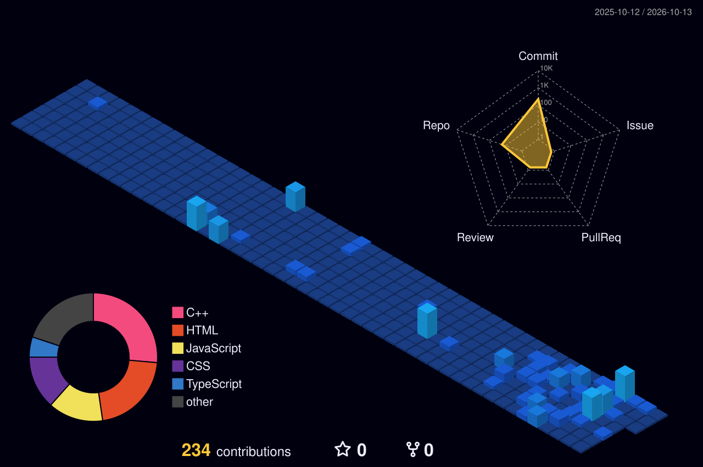

  

<h1 align="center">
  
</h1>

<table>
  <tr>
    <td width="52%" valign="top">

### <h2>  Hi, welcome! </h2>

- 🎓 <b><i>B.Tech CSE Student</i></b>
- 📚 <b><i>Currently Learning: Data Structures & Algorithms, Backend Development</i></b>
- 🛠️ <b><i>Strengthening my DSA and problem-solving skills</i></b>
- 💻 <b><i>Exploring full-stack web development</i></b>

### 🔗 Let's Connect

  

   </td>
    <td width="48%" align="center" valign="middle">
      
       
      
    </td>
  </tr>
</table>

  

<!-- 

  -->

## 🌐 Socials:
    

# 💻 Tech Stack:
           

## 📊 GitHub Analytics

  

  
  

  

 
 
 

 

  

## 🏆 GitHub Trophies

### 🔝 Top Contributed Repo

---

  

### Profile Views

<table>
  <tr>
    <td>

    </td>
  </tr>
</table>

<!-- Proudly created with GPRM ( https://gprm.itsvg.in ) -->
